  

🐾 为格雷世界，造点有趣的东西。

  <strong><a href="https://miaokatze.com/">前往个人主页 → miaokatze.com</a></strong> 
  我的非官方 GTNH 模组介绍与特色展示

### 项目与快捷入口

| 项目 | 简介 | 快捷入口 |
| --- | --- | --- |
| [GT-Simple-Wireless-Network](https://github.com/MIAOKATZE/GT-Simple-Wireless-Network) | 无线 EU · 实时监控 · 红石控制 | [下载](https://github.com/MIAOKATZE/GT-Simple-Wireless-Network/releases) · [Wiki](https://github.com/MIAOKATZE/GT-Simple-Wireless-Network/wiki) · [反馈](https://github.com/MIAOKATZE/GT-Simple-Wireless-Network/issues) |
| [GT-Interesting-Thing](https://github.com/MIAOKATZE/GT-Interesting-Thing) | 猫猫商店 · 趣味道具 · 探索与奖励 | [下载](https://github.com/MIAOKATZE/GT-Interesting-Thing/releases) · [Wiki](https://github.com/MIAOKATZE/GT-Interesting-Thing/wiki) · [反馈](https://github.com/MIAOKATZE/GT-Interesting-Thing/issues) |
| [GT-Steam-Reborn](https://github.com/MIAOKATZE/GT-Steam-Reborn) | 蒸汽机器 · 奇点枢纽 · 跨维度物流 | [下载](https://github.com/MIAOKATZE/GT-Steam-Reborn/releases) · [Wiki](https://github.com/MIAOKATZE/GT-Steam-Reborn/wiki) · [反馈](https://github.com/MIAOKATZE/GT-Steam-Reborn/issues) |

喜欢这些模组的话，欢迎点一颗 <strong>⭐ Star</strong>，支持下一次更新。

  
  
  

点击上方按钮进入仓库，再点右上角 ☆ Star。

