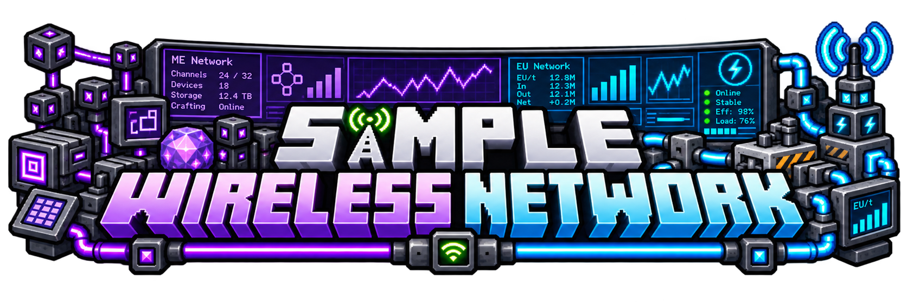

<strong>🐾 为格雷世界，造点有趣的东西。</strong>

   
  更多模组介绍与特色展示，尽在个人主页。

<table align="center">
  <tr>
    <td align="center" valign="top" width="33%">
      

       
      无线 EU · 实时监控 · 红石控制  
      
      
        
      
    </td>
    <td align="center" valign="top" width="33%">
      

       
      猫猫商店 · 趣味道具 · 探索奖励  
      
      
        
      
    </td>
    <td align="center" valign="top" width="33%">
      

       
      蒸汽机器 · 奇点枢纽 · 跨维物流  
      
      
        
      
    </td>
  </tr>
</table>

  喜欢我的模组，欢迎点一颗 <strong>⭐ Star</strong>，支持下一次更新。 
  非官方 GTNH 模组 · 点击 Star 按钮进入仓库，再点右上角 ☆ Star。

